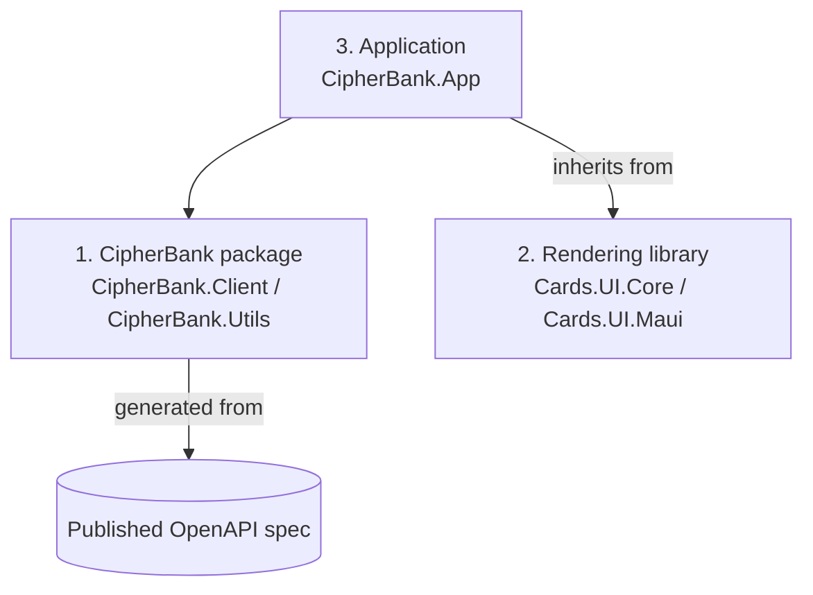

# CipherBank-App Architecture: Strict Three-Part Separation

Status: proposed target architecture; current code and CI do not implement this yet. It applies to the `arch/strict-separation` stack. Whether it will replace [../architecture.md](../architecture.md) or sit alongside it as a companion to that overview is still open. Components and controls described below (for example `CipherBank.Client.Api`, `CipherBank.Architecture.Tests`, the forbidden-package check, the PR checklist item and `src-ip-guard`) do not exist yet.

## Purpose

CipherBank-App is **one implementation of a CipherBank client, held as the standard one**. CipherBank-src is the backend that third parties are intended to use to build their own CipherBank-App-like applications and use CipherBank services for transactions. Third-party clients and this App will access CipherBank-src only through the published API contract. Third-party clients may reuse parts 1 and 2 or write their own; the App gets no privileged access to the backend. To make this possible, the code is split into three parts with one-way dependencies.

Package layout (Connor, Oct 24): `CipherBank` is the root package, with `CipherBank.Client` and `CipherBank.Utils` as sub-packages under it. `Cards.UI` is the rendering library's name. For now all packages live in this App repo, but each will be an isolated package with its own project and its own dependency rules, so it can later be published or moved without changes. Living in the repo and being a package are not mutually exclusive. Naming: `CipherBank` is the root package family and namespace prefix. `CipherBank.Client` and `CipherBank.Utils` are packages under it, and `CipherBank.Client.Api` is the generated-code project inside the `CipherBank.Client` package (it has its own row in the dependency table because its rules are stricter).

## The three parts

### 1. CipherBank package (`CipherBank`: `CipherBank.Client`, `CipherBank.Utils`)

Reusable, UI-free code in isolated packages under the `CipherBank` root (`CipherBank.Client` for the API client and services, `CipherBank.Utils` for shared utilities). These packages live in this repo for now. It will contain the reusable client functionality someone needs to build their own CipherBank front end on any platform (each application supplies its own platform implementations and UI):

- `CipherBank.Client.Api`: client code that will be generated from the published OpenAPI spec for the endpoints that really exist, with the generator tool still to be chosen (checked in, with a planned CI job that regenerates it and fails on diff). The existing mocks are kept as hand-written sections alongside the generated code until their endpoints exist in the contract.
- Service abstractions and implementations (auth, wallet, transactions, quotes) built on the generated client.
- Per-action challenge client, canonical parameter encoder, key custody abstractions (`ISecureStore`, `IUserKeyStore`). The published contract binds a challenge to a purpose (GRAB or OVERWRITE) and allows one live challenge per user, so the challenge client must run actions one at a time per user, through a per-user queue or lock. Cancellation stays in the MVVM layer: view models cancel queued or running actions, and the challenge client only honors the cancellation it is given. It defines no parameter hash yet, so the encoder stays provisional until the contract adds one.
- Validation, rate limiting, log redaction, certificate pin policy, optional local persistence.
- DI extensions (`AddCipherBankClient(...)`) and `CipherBank.Client.Testing` fakes.

It must not reference any UI framework (MAUI, Avalonia, CommunityToolkit.Mvvm) or parts 2/3. Platform capabilities (secure storage, HTTP handlers) are interfaces here and implemented by the application.

### 2. Rendering library (`Cards.UI.*`)

Unspecialized and cross-platform. It knows nothing about CipherBank.

- **View models** that know how to render for a given view: base VM types, card/page/pop-up/feed VM contracts, navigation, dialog, motion and theme abstractions, animation math (`Cards.UI.Core`).
- **Views** that accept those view models: cards, pages, pop-ups, feeds, plus controls, converters and generic style tokens (`Cards.UI.Maui` first). Part 2 will be kept platform-neutral so that other heads such as Avalonia can be added later; Avalonia is planned but not required now (pending maintainer confirmation).

It must not reference anything in `CipherBank.*`.

### 3. Application (`CipherBank.App`)

The CipherBank MAUI app. It **inherits from part 2** (its pages, cards and VMs derive from the rendering library's templates and bases) and **uses part 1** (all backend access goes through `CipherBank.Client` interfaces). It holds the concrete view models, views, brand styles, user-facing strings, DI composition and platform entry points/implementations (Keychain, Android Keystore, DPAPI).

## Dependency rules

| Part | May reference | Must not reference |
|---|---|---|
| 1 `CipherBank.Utils` | BCL, Microsoft.Extensions.* | any UI framework, `CipherBank.Client`, parts 2 and 3, CipherBank-src |
| 1 `CipherBank.Client` | BCL, Microsoft.Extensions.*, `CipherBank.Utils`, crypto libraries, optional EF Core/SQLite | any UI framework, parts 2 and 3, CipherBank-src |
| 1 `CipherBank.Client.Api` | BCL, System.Net.Http/Json | everything else |
| 2 `Cards.UI.Core` | BCL, CommunityToolkit.Mvvm | `CipherBank.*`, platform UI frameworks |
| 2 `Cards.UI.Maui` | `Cards.UI.Core`, MAUI | `CipherBank.*` |
| 3 `CipherBank.App` | parts 1 and 2, MAUI | CipherBank-src |

These rules will be enforced by project references, a planned `CipherBank.Architecture.Tests` project (assembly/namespace rules), new analyzer rules in `CipherBank-app.Analyzers` (the current analyzers do not enforce these boundaries), and a planned build-time check on forbidden package references. Suppressions (`#pragma`, `SuppressMessage`, `NoWarn`, severity downgrades) are not allowed.

## Backend access: OpenAPI only

Target state: the application will talk to the backend **only through the published OpenAPI spec**. Endpoints, schemas, action IDs and error codes will come from the generated `CipherBank.Client.Api` types. There will be no app-only headers, fields or side channels; if the client needs something, it must be added to the spec first. (Today the app uses its existing service and HTTP layers.)

## Parity without dependency

The App and CipherBank-src aim for **feature parity**, but **neither depends on the other**: no project, package, submodule, shared-source or build references in either direction. The only shared artifacts are the OpenAPI contract and its published contract-level test vectors. A new feature is specified in the contract, then implemented independently on each side, and verified by planned contract tests (generated-client regen check, the published golden vectors for canonical encoding).

## src IP boundary

CipherBank-src is protected IP; it holds our specialized operations for how the systems work. **Nothing from src internals** (algorithms, specialized operations, internal logic, non-contract types, internal names or comments) may appear in the App, the `CipherBank.Client` package or the public spec beyond the API contract. The spec states *what* the API does, never *how* the backend does it.

Planned guards (not yet in place):

- Every PR's review checklist will include: "src IP boundary: no src internals in App, Client package or spec beyond the API contract."
- A CI check (`src-ip-guard`) will fail on src namespaces/identifiers, references to src assemblies, or spec content not present in the pinned published contract.

## Branch role

`arch/strict-separation` is main plus the strict separation of responsibilities, kept up to date with main. Main is the proof of concept, where some separation was set aside for expediency. Once the app is feature complete, this branch is the starting point for the production app.

The goal is parity with main until the maintainers decide on the cutover from the proof of concept; the cutover criterion is still to be decided. The bot pipeline owns the branch for now. It will maintain the branch, prepare sync PRs that bring main into it, and port main changes into the right part. Humans audit it periodically. Until the repository owner explicitly approves merges on `arch/strict-separation`, every PR in the stack, including sync PRs from main, stays a draft and nothing is merged into the branch.

Client neutrality: the App is one implementation of a CipherBank client, held as the standard one, not a privileged client. The published OpenAPI spec exists so anyone can easily write their own CipherBank-App-like client and use CipherBank services for transactions. Part 1 will provide the reusable client functionality needed to build a client on any platform. Each application supplies its own platform implementations (secure storage, HTTP handlers) and UI. Nothing App-specific may appear in the spec or in part 1.

## Related documents

- [../architecture.md](../architecture.md): current layered overview
- [../core/README.md](../core/README.md), [../app/README.md](../app/README.md)
