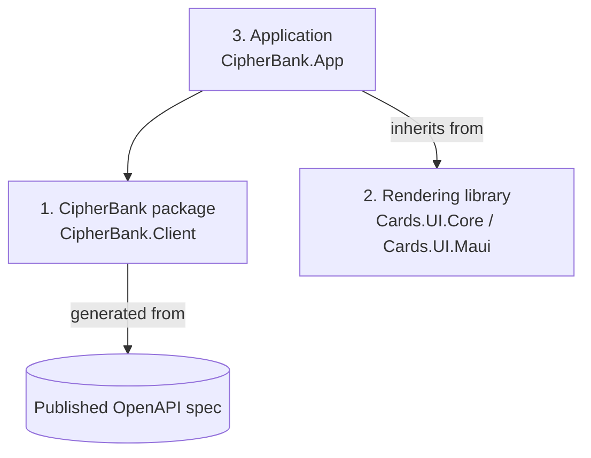

# CipherBank-App Architecture: Strict Three-Part Separation

Status: design (applies to `arch/strict-separation`). Supersedes the layering in [../architecture.md](../architecture.md) once the separation lands.

## Purpose

CipherBank-App is the **base-model reference client** for CipherBank and is intended to be the standard client. Other clients (other platforms, other front ends, third parties) are variants built from the same reusable pieces. To make that possible, the code is split into three parts with one-way dependencies.

## The three parts

### 1. CipherBank package (`CipherBank.Client`)

Reusable, UI-free code, to be ported to its own package later. It contains everything someone needs to build their own CipherBank front end on any platform:

- `CipherBank.Client.Api`: client code generated from the published OpenAPI spec (checked in, regenerated in CI, fails on diff).
- Service abstractions and implementations (auth, wallet, transactions, quotes) built on the generated client.
- Per-action challenge client, canonical parameter encoder, key custody abstractions (`ISecureStore`, `IUserKeyStore`).
- Validation, rate limiting, log redaction, certificate pin policy, optional local persistence.
- DI extensions (`AddCipherBankClient(...)`) and `CipherBank.Client.Testing` fakes.

It must not reference any UI framework (MAUI, Avalonia, CommunityToolkit.Mvvm) or parts 2/3. Platform capabilities (secure storage, HTTP handlers) are interfaces here and implemented by the application.

### 2. Rendering library (`Cards.UI.*`, name provisional)

Unspecialized and cross-platform. It knows nothing about CipherBank.

- **View models** that know how to render for a given view: base VM types, card/page/pop-up/feed VM contracts, navigation, dialog, motion and theme abstractions, animation math (`Cards.UI.Core`).
- **Views** that accept those view models: cards, pages, pop-ups, feeds, plus controls, converters and generic style tokens (`Cards.UI.Maui`; other platform heads such as Avalonia later).

It must not reference anything in `CipherBank.*`.

### 3. Application (`CipherBank.App`)

The CipherBank MAUI app. It **inherits from part 2** (its pages, cards and VMs derive from the rendering library's templates and bases) and **uses part 1** (all backend access goes through `CipherBank.Client` interfaces). It holds the concrete view models, views, brand styles, user-facing strings, DI composition and platform entry points/implementations (Keychain, Android Keystore, DPAPI).

## Dependency rules

| Part | May reference | Must not reference |
|---|---|---|
| 1 `CipherBank.Client` | BCL, Microsoft.Extensions.*, crypto libraries, optional EF Core/SQLite | any UI framework, parts 2 and 3, CipherBank-src |
| 1 `CipherBank.Client.Api` | BCL, System.Net.Http/Json | everything else |
| 2 `Cards.UI.Core` | BCL, CommunityToolkit.Mvvm | `CipherBank.*`, platform UI frameworks |
| 2 `Cards.UI.Maui` | `Cards.UI.Core`, MAUI | `CipherBank.*` |
| 3 `CipherBank.App` | parts 1 and 2, MAUI | CipherBank-src |

Enforced by project references, `CipherBank.Architecture.Tests` (assembly/namespace rules), analyzers in `CipherBank-app.Analyzers`, and a build-time check on forbidden package references. Suppressions (`#pragma`, `SuppressMessage`, `NoWarn`, severity downgrades) are not allowed.

## Backend access: OpenAPI only

The application talks to the backend **only through the published OpenAPI spec**. Endpoints, schemas, action IDs and error codes come from the generated `CipherBank.Client.Api` types. There are no app-only headers, fields or side channels; if the client needs something, it is added to the spec first.

## Parity without dependency

The App and CipherBank-src aim for **feature parity**, but **neither depends on the other**: no project, package, submodule, shared-source or build references in either direction. The OpenAPI contract is the only shared artifact. A new feature is specified in the contract, then implemented independently on each side, and verified by contract tests (generated-client regen check, shared golden vectors for canonical encoding).

## src IP boundary

CipherBank-src is protected IP; it holds our specialized operations for how the systems work. **Nothing from src internals** (algorithms, specialized operations, internal logic, non-contract types, internal names or comments) may appear in the App, the `CipherBank.Client` package or the public spec beyond the API contract. The spec states *what* the API does, never *how* the backend does it.

Guards:

- Every PR's review checklist includes: "src IP boundary: no src internals in App, Client package or spec beyond the API contract."
- CI check (`src-ip-guard`) fails on src namespaces/identifiers, references to src assemblies, or spec content not present in the pinned published contract.

## Related documents

- [../architecture.md](../architecture.md): current layered overview
- [../core/README.md](../core/README.md), [../app/README.md](../app/README.md)
